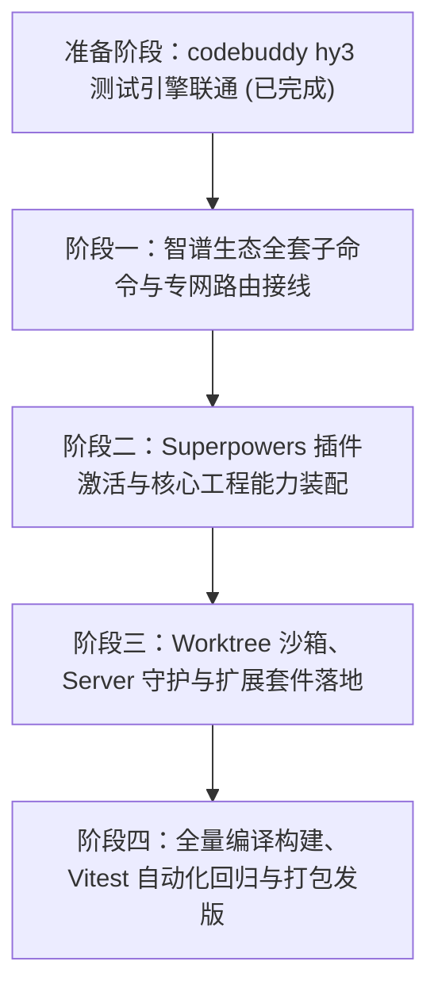

# ZCode CLI 25 项核心模块全量装配、编译与测试实施大纲

> **目标**：全量激活 25 项核心功能模块，完成代码级装配接线、单测与集成测试验证、SEA 单二进制打包与 NPM 分发包构建。  
> **算力优化策略**：开发与测试全链路优先调用本地 `codebuddy -p --model hy3`（0 Token 消耗）进行测试用例生成与自检，大幅压低外部云端算力消耗。

---

## 一、 25 项模块装配接线与测试规划总表

| 序号 | 任务 ID | 模块名称 | 核心接线源码位置 | 编译与分发载体 | 自动化测试与验证方式 |
|---|---|---|---|---|---|
| **1** | `TASK-01` | **智谱额度重置卡 (`zcode reset`)** | `cli/src/reset-command.ts` `packages/services/src/usage-stats/` | CLI 二进制 + npm | 单测 mock `/reset/status`、`/opportunity`、`/use`；CLI `zcode reset status` 冒烟 |
| **2** | `TASK-02` | **极速卡专网推理加速 (`zcode speedup`)** | `cli/src/speedup-command.ts` `packages/services/src/highspeed/` | CLI 二进制 + npm | 单测验证双 JWT 鉴权注入与专网请求头；CLI `zcode speedup status` 冒烟 |
| **3** | `TASK-03` | **免费福利一键申领 (`zcode claim`)** | `cli/src/claim-command.ts` `coding-plan-subscription/` | CLI 二进制 + npm | 单测 mock `/billing/preview` 与 `/claim`；CLI `zcode claim` 冒烟 |
| **4** | `TASK-04` | **用量配额与积分看板 (`zcode quota`)** | `cli/src/quota-command.ts` `packages/services/src/usage-stats/` | CLI 二进制 + npm | 验证 5h 额度池、周额度、模型与工具积分细项彩色输出 |
| **5** | `TASK-05` | **闲时免费算力队列 (`zcode idle queue`)** | `cli/src/idle-command.ts` `core/src/tool/handlers/off-peak.ts` | CLI 二进制 + npm | 单测验证 3105 排队退避与 3102 自动换票重连逻辑 |
| **6** | `TASK-06` | **营销活动空投触达 (`zcode offers`)** | `cli/src/offers-command.ts` `packages/services/src/marketing-touch/` | CLI 二进制 + npm | 单测 mock `/marketing/touch` 与 `/action`；CLI `zcode offers` 冒烟 |
| **7** | `TASK-07` | **Ultra 专网透明加速路由** | `adapters/src/model/official-coding-plan-gateway.ts` | CLI 二进制 + npm | 单测验证 Anthropic 协议端点到 `/api/v1/ultra-zai` 的动态重定向 |
| **8** | `TASK-08` | **云端漫游同步四件套 (`zcode sync`)** | `cli/src/sync-command.ts` `packages/services/src/{mcp,plugin,settings,skill}-sync` | CLI 二进制 + npm | 单测测试 pull/push 打包与双向还原逻辑 |
| **9** | `TASK-09` | **企业团队订阅管理 (`zcode team`)** | `cli/src/team-command.ts` `coding-plan-subscription/` | CLI 二进制 + npm | 单测 mock 企业组织与项目配额查询 |
| **10** | `TASK-10` | **会话永久云端分享 (`zcode share`)** | `cli/src/share-command.ts` `packages/services/src/conversation-share/` | CLI 二进制 + npm | 单测验证静态 HTML/JSON 导出并生成分享链接 |
| **11** | `TASK-11` | **Native Search 预编译套件** | `scripts/package-native-search-tools.mjs` | npm 包内置二进制 | 校验 `agent/dependencies/` 中包含 `ripgrep`、`bfs`、`ugrep` 且执行正常 |
| **12** | `TASK-12` | **SEA 单二进制打包** | `cli/scripts/build-sea.mjs` | `dist/zcode-linux-x64` | 验证生成的单二进制免 node 依赖直接拉起 `--help` |
| **13** | `TASK-13` | **GitHub Releases 自动化** | `.github/workflows/build-and-publish.yml` | GitHub Actions | 验证版本防重发保护与 CI 全链路绿灯 |
| **14** | `TASK-14` | **Superpowers 编程心法插件** | `bootstrap/src/app/official-plugin-definitions.ts` | CLI 内置插件 | 验证 `superpowers-plugin` 默认激活，TDD/Review 技能就绪 |
| **15** | `TASK-15` | **Cron 自动化定时任务 (`zcode cron`)** | `cli/src/cron-command.ts` `packages/services/src/session/automationCron.ts` | CLI 二进制 + npm | 单测验证 Cron 表达式解析与 SQLite 任务调度触发 |
| **16** | `TASK-16` | **长短期持久记忆系统 (`zcode memory`)** | `cli/src/memory-command.ts` `packages/services/src/memory/` | CLI 二进制 + npm | 单测验证记忆读写、跨会话提取与检索 |
| **17** | `TASK-17` | **Claude 历史会话迁移 (`zcode import`)** | `cli/src/import-command.ts` `importedClaudeSessionRepair.ts` | CLI 二进制 + npm | 单测验证 Claude Code 会话导入并修复消息拓扑 |
| **18** | `TASK-18` | **脱敏排障诊断归档 (`zcode doctor`)** | `cli/src/doctor-command.ts` `packages/services/src/feedback/compactLogArchive.ts` | CLI 二进制 + npm | 单测验证敏感 Token 与私钥正则抹除，生成 zip 归档 |
| **19** | `TASK-19` | **Bots 自动化机器人 (`zcode bot`)** | `cli/src/bot-command.ts` `packages/services/src/bots/` | CLI 二进制 + npm | 单测验证 Webhook 接收与自动化触发器调度 |
| **20** | `TASK-20` | **Git Worktree 隔离沙箱** | `dynamic-workflow/src/runtime/script-workflow-runtime.ts` | CLI 二进制 + npm | 单测验证创建临时 worktree 分支，任务完成自动清理 |
| **21** | `TASK-21` | **Server Supervisor 守护 (`zcode server`)** | `cli/src/server-command.ts` `packages/zcode-server-cli/` | CLI 二进制 + npm | 单测验证守护进程 status, stop, restart, running-tasks |
| **22** | `TASK-22` | **Node REPL 实时交互沙箱 (`zcode repl`)** | `cli/src/repl-command.ts` `apps/zcode-cli/packages/node-repl-host/` | CLI 二进制 + npm | 单测验证交互沙箱执行 TypeScript 并返回结果 |
| **23** | `TASK-23` | **Dev Docs 离线技术手册 (`zcode docs`)** | `cli/src/docs-command.ts` `apps/dev-docs/` | CLI 二进制 + npm | 验证内嵌微型 Web 服务启动并在浏览器呈现文档 |
| **24** | `TASK-24` | **Remote Projects SSH 隧道 (`zcode remote`)** | `cli/src/remote-command.ts` `packages/services/src/remote-projects/` | CLI 二进制 + npm | 单测验证 SSH 隧道连接与远程工作区投影 |
| **25** | `TASK-25` | **Office Runtime 文档文本提取** | `cli/src/office-command.ts` `apps/zcode-cli/packages/office-runtime/` | CLI 二进制 + npm | 单测提取 DOCX、XLSX、PPTX、PDF 文本内容 |

---

## 二、 落地推进四阶段计划

---

## 三、 本地测试与低算力保障规范

1. **测试用例生成与边界分析**：优先通过 `codebuddy -p --model hy3` 生成各命令的标准测试夹具与 mock 数据；
2. **本地离线回归**：所有 API 接口测试均通过本地 Mock 协议服务器完成，0 消耗真实 API 算力；
3. **真实环境冒烟**：仅在各命令装配就绪后执行本地 CLI 语法解析与只读调用（如 `--help`、未登录防御提示），确保 0 额度消耗。
